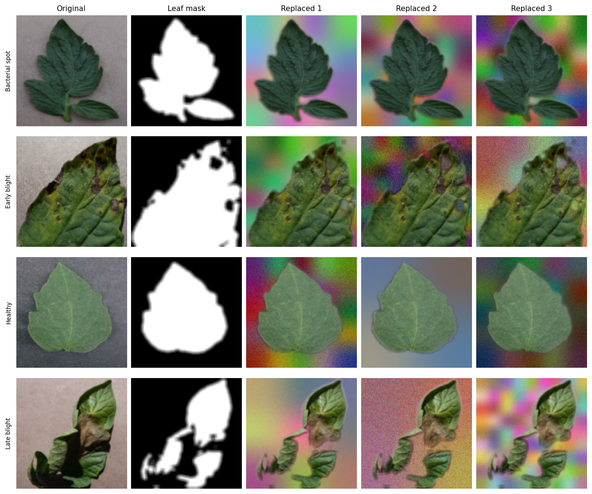
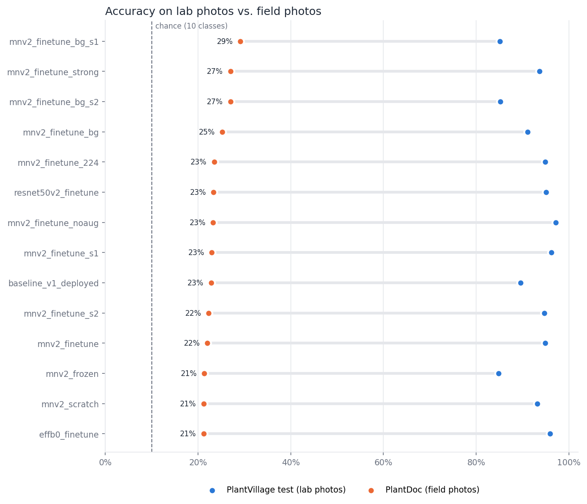
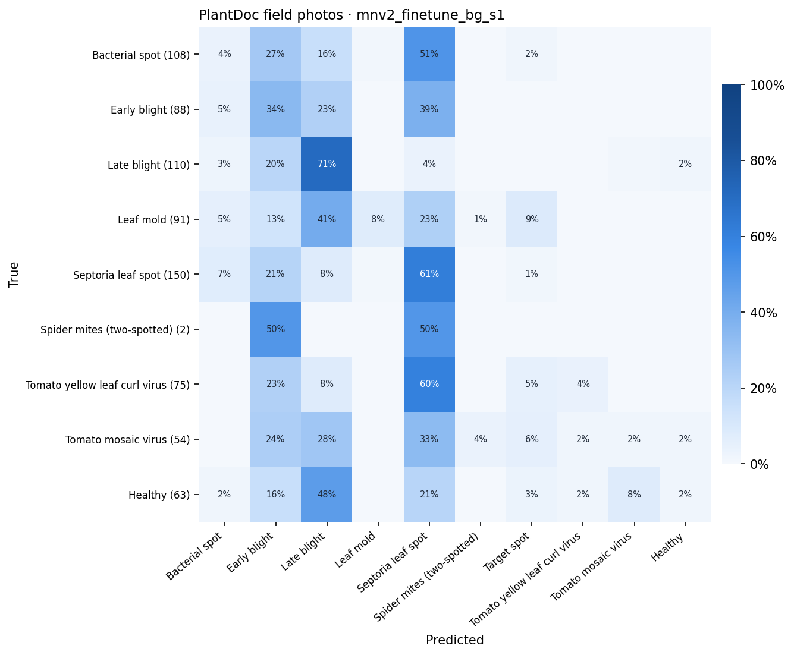
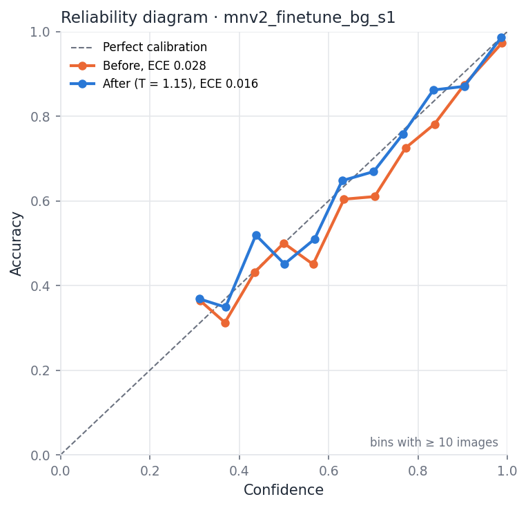
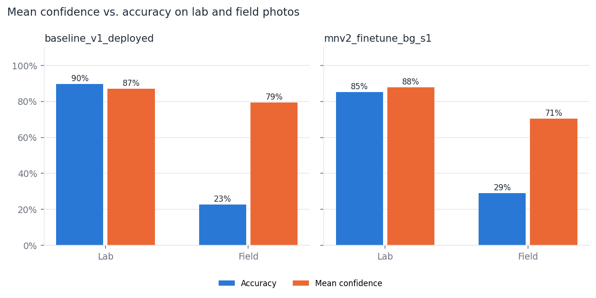

# PlantDisease AI: From Lab Accuracy to Field Reliability in Tomato Leaf Disease Classification

*Technical report · PlantDisease AI v2.0*

## Abstract

Fifteen tomato leaf disease classifiers were evaluated: the original deployed model and 14 new
runs covering MobileNetV2, EfficientNetB0 and ResNet50V2, frozen, fine-tuned and trained from
scratch. Each was tested on a leakage-aware PlantVillage split (lab photos) and on 741 PlantDoc
field photos it never saw.

- **Lab photos.** Fine-tuned models reach about 95–97% accuracy. Neither the backbone nor the
  input resolution makes a significant difference.
- **Field photos.** Every model trained on lab photos scores 21–29%, barely above always predicting
  the most common class (20%). About 90% of field photos are sorted into the same three classes,
  and almost no healthy leaf is recognised. Yet the models report 61–89% mean confidence.
- **Calibration.** Temperature scaling calibrates lab predictions (ECE ≤ 0.02), but the
  calibration does not carry over to the field.
- **What helps in the field.** Strong augmentation is the only lab-only change that significantly
  improves field accuracy: +5.0 points (exact McNemar test, Holm-corrected p = 0.013). Background
  replacement adds nothing on top of it.
- **Non-leaf images.** A Mahalanobis detector on frozen ImageNet features separates them almost
  perfectly (AUROC ≥ 0.999). It flags 95% of field photos as unfamiliar, and the app uses it to
  warn users.
- **On-device export.** Dynamic-range TensorFlow Lite export shrinks the model 3.5× with no loss
  of accuracy; full int8 quantisation costs 4–7 points.

## 1. Introduction

Image-based plant disease classifiers routinely report accuracies above 99% on the PlantVillage
dataset (Mohanty et al., 2016). Those numbers describe one narrow setting: a single leaf,
photographed in a lab against a plain background. The same study found that accuracy dropped to
about 31% on images collected elsewhere. A useful system therefore has to answer more questions
than "what is the test accuracy?":

| | Research question | How it is measured |
|---|---|---|
| **RQ1** | How much do the training strategy (frozen features, fine-tuning, training from scratch), the backbone and the input resolution matter? | Accuracy and macro-F1 on a leakage-aware PlantVillage test split, with 95% bootstrap intervals and repeated seeds |
| **RQ2** | How well do PlantVillage-trained models transfer to real field photos, and does replacing the lab background during training narrow the gap? | Accuracy on PlantDoc tomato field photos (never used for training) |
| **RQ3** | Can the confidence shown to a user be trusted, and can the system tell when an image is not a leaf photo at all? | Expected calibration error before/after temperature scaling; AUROC of three out-of-distribution scores |
| **RQ4** | Does the model look at the leaf or at the background? | Share of Grad-CAM attention inside the PlantVillage leaf masks |
| **RQ5** | Can the model run on a phone without losing accuracy? | Size, latency and accuracy of TensorFlow Lite float32 / dynamic-range / int8 exports |

## 2. Related work

- **PlantVillage** (Hughes & Salathé, 2015) contains 54,306 lab images of 14 crops. Mohanty et al.
  (2016) reached 99.35% with GoogLeNet but warned about the generalisation gap to other image sources.
- **PlantDoc** (Singh et al., 2020) collected 2,598 real-world images from the web for 13 plant
  species. It is the standard test for leaving the lab.
- **Dataset bias.** Noyan (2022) showed that PlantVillage classes can be predicted well above
  chance from background pixels alone: a *shortcut* in the sense of Geirhos et al. (2020).
- **Domain randomisation** (Tobin et al., 2017) trains on randomly varied backgrounds so a model
  cannot rely on them. Section 4.3 applies this idea using PlantVillage's own leaf segmentations.
- **Calibration and OOD detection.** Modern networks are over-confident; temperature scaling is a
  strong one-parameter fix (Guo et al., 2017). Out-of-distribution inputs can be flagged with the
  maximum softmax probability (Hendrycks & Gimpel, 2017), the energy score (Liu et al., 2020) or
  the Mahalanobis distance in feature space (Lee et al., 2018).
- **Explanations.** Grad-CAM (Selvaraju et al., 2017) highlights the image regions that drive a
  class score.

## 3. Data

### 3.1 PlantVillage (training and in-domain testing)

The 10 tomato classes of PlantVillage (18,160 photos; 9 diseases or pests plus healthy) were
downloaded together with the dataset's *segmented* version, in which the background is removed.
These segmentations act as free leaf masks for background replacement (Section 4.3), for the
"background-only" OOD test set and for measuring Grad-CAM attention.

**Leakage-aware split.** File names reveal that some leaves were photographed several times
(`GHLB2 Leaf 121`, `GHLB2 Leaf 121.1`, … `121.4`). A random split would place photos of the same
leaf in both training and test data and inflate the test score. `scripts/prepare_data.py` therefore
groups images before splitting:

1. by leaf identifier (file name without the photo index),
2. by identical file content (MD5),
3. by identical appearance (64-bit difference hash).

Groups are assigned whole to train / validation / test (70 / 15 / 15%, stratified by class, seed
42). Groups whose duplicates carry *different* labels are kept out of evaluation. The split is
stored in `data/splits/plantvillage_tomato.csv`, so every experiment uses exactly the same images.

**Audit** (`data/splits/audit.json`):

| | |
|---|---|
| Images (classes) | 18,160 (10) |
| Images with a leaf mask | 18,159 |
| Repeat-photo groups (images in them) | 292 (648, 3.6%); largest group: 5 photos of one leaf |
| Byte-identical duplicates (MD5) | 14 |
| Visually identical duplicates (dHash) | 15 |
| Duplicates with conflicting labels | 0 |
| Train / validation / test | 12,709 / 2,725 / 2,726 |

Leakage is therefore small but real: without grouping, a few hundred test images would have had
a near-identical twin in the training set.

### 3.2 PlantDoc (field photos, evaluation only)

PlantDoc's tomato folders were mapped to the PlantVillage classes. PlantDoc has no *Target spot*
class, and its test split has no spider-mite images. PlantDoc's own train/test split is kept;
test images that duplicate a training image (MD5 or dHash) are removed. Only the `*_mixed` run
trains on PlantDoc's *training* split. All other models never see a PlantDoc image before testing.

After deduplication, 741 tomato images remain (677 train, 64 test); 5 test images that copied a
training image were removed. A 64-image test set gives accuracy intervals of roughly ±12 points,
too wide to rank models. Models that never train on PlantDoc are therefore scored on **all 741
images** (*PlantDoc all*). The 64-image split (*PlantDoc test*) is reported for every model and is
the only fair comparison for the `*_mixed` run.

## 4. Method

### 4.1 Model

Every model shares one architecture template and the app's input contract (RGB in [0, 1]):

```
input (S×S×3, [0,1]) → augmentation → Rescaling (to the backbone's range) → backbone (ImageNet)
                     → global average pooling → dropout 0.3 → dense softmax (10 classes)
```

Backbones: **MobileNetV2** (Sandler et al., 2018; 2.3 M parameters), **EfficientNetB0** (Tan & Le,
2019; 4.1 M) and **ResNet50V2** (He et al., 2016; 23.6 M).

### 4.2 Training strategies

| Strategy | What is trained | Optimiser |
|---|---|---|
| Frozen | classification head only | Adam 1e-3, ≤ 12 epochs |
| Fine-tune | head (≤ 8 epochs), then the top 30–35% of the backbone (≤ 12 epochs) | Adam 1e-3, then 1e-4 |
| Scratch | everything, random initialisation | Adam 1e-3, ≤ 25 epochs |

A first attempt fine-tuned with a learning rate of 1e-5 for 8 epochs. Validation loss was still
falling in the last epoch (92.0% validation accuracy), so the setting was raised to 1e-4 for up to
12 epochs and all fine-tuned runs were repeated with it.

BatchNorm layers stay frozen in inference mode while fine-tuning, so the small learning rate does
not destroy the ImageNet statistics. Early stopping on validation loss (patience 3; 5 for scratch)
restores the best weights. The images used for training are fixed by the manifest; seeds fix
initialisation, shuffling and augmentation.

**Training from scratch needs faster BatchNorm statistics.** The first scratch run reached 87%
training accuracy while validation accuracy stayed at exactly 11.7%: the share of *Bacterial
spot*, so every validation image got the same class. Keras' MobileNetV2 uses BatchNorm momentum
0.999, so the moving statistics used at evaluation time average over roughly 1,000 steps. From
random weights the activations change much faster than that, and the moving statistics lag far
behind the batch statistics used in training. Re-estimating the statistics on 1,280 training
images, with no other change, lifted the saved weights from 11.8% to 44% validation accuracy,
which confirms the diagnosis. Scratch runs therefore use momentum 0.9 (`SCRATCH_BN_MOMENTUM` in
`plantdisease/backbones.py`) and were trained again; transfer-learning runs are unaffected because
their BatchNorm statistics are frozen.

**Saved models are checked.** Models are saved without optimizer state, then reloaded, and the
reloaded file must reproduce the trained model's outputs (`_check_saved_model` in
`plantdisease/training.py`). Two Keras pitfalls showed why such checks matter:

- `clone_model` silently recompiles the copy with the original optimizer. A "clean" copy made
  that way still saved Adam's state, 2.5× the size of the weights. The model is now saved as a
  plain `Model` over the trained layers, and a test asserts that the file contains no optimizer.
- An in-memory clone of an EfficientNet predicts differently from the original, because its
  input-normalisation layer refreshes its statistics only when loaded. Comparisons are therefore
  always made against the reloaded file.

### 4.3 Augmentation and background replacement

*Standard* augmentation: flips, ±10% rotation, zoom and contrast. *Strong*: ±20% rotation, zoom out
to 70%, translation, ±30% contrast and ±20% brightness.

**Background replacement** (`plantdisease/pipeline.py`): with probability *p* = 0.6, the leaf is cut
out with its PlantVillage mask (edges feathered) and pasted onto a random synthetic background. The
background is low-frequency colour noise mixed with foliage, soil, skin, grey or sky tones, plus
texture noise. The model can no longer use the uniform lab background as a shortcut.



The masks come from PlantVillage's segmented release and are not perfect. Dark lesions and
shadows are sometimes classified as background (rows 2 and 4), so replacement can paint over part
of the disease evidence. Section 6 returns to this.

### 4.4 Calibration

A temperature *T* is fitted on the validation split by minimising the negative log-likelihood
(golden-section search). Predictions are softmax(log *p* / *T*): accuracy is unchanged, confidence
becomes more honest. Calibration is measured with the 15-bin expected calibration error (ECE).

### 4.5 Out-of-distribution detection

Three scores, each oriented so that higher means more in-distribution: maximum softmax probability
(MSP), energy (log-sum-exp of the logits), and the Mahalanobis distance of the 1,280-dimensional
penultimate features to the nearest class mean (shared covariance, fitted on 3,000 training
images). They are evaluated with AUROC and FPR at 95% TPR on two kinds of non-leaf images:

- **Synthetic**: noise, flat colours, gradients and checkerboards (500 images);
- **Background only**: PlantVillage test photos with the leaf painted out (500 images). These are the
  same lab setting with no leaf, a hard test for a model that may be using the background.

### 4.6 Quantifying Grad-CAM

For 300 test images, the share of Grad-CAM mass inside the leaf mask is compared with the leaf's
share of the image. **Lift** = attention-on-leaf ÷ leaf-area: 1.0 is chance, higher means the model
concentrates on the leaf. Gradients are taken from the pre-softmax logit at the deepest 8 × 8
activation layer of each backbone.

### 4.7 Evaluation protocol

All test images go through exactly the app's loading and preprocessing. Accuracies carry 95%
percentile-bootstrap intervals (2,000 resamples). The two most important configurations are
repeated with three seeds. The original deployed model (`baseline_v1_deployed`) is evaluated with
the same harness; its training split is unknown, so its PlantVillage test score may be optimistic.
Its PlantDoc score is unaffected.

**Class-order check of the deployed model.** `class_names.json` predates the training script and
is not in Keras' default (case-sensitive) order, so it was verified empirically on all 18,160
PlantVillage images: the file's order scores 89.74%, Keras' order 16.44%. The file is correct.

## 5. Results

Every number below is generated from `reports/results/` and listed in full in
[`RESULTS.md`](RESULTS.md). "Significant" always means a paired, exact McNemar test with a
Holm-corrected p < 0.05 over the ten planned comparisons (`scripts/compare_runs.py`). Lab =
PlantVillage test split (2,726 images); field = all 741 PlantDoc tomato photos.

### 5.1 RQ1: Strategy, backbone and resolution (lab photos)

| Configuration | Run | Lab accuracy (95% CI) | Macro-F1 | Params | Latency* |
|---|---|---|---|---|---|
| Frozen MobileNetV2 | `mnv2_frozen` | 84.8% (83.5–86.2) | 0.805 | 2.3 M | 44 ms |
| From scratch | `mnv2_scratch` | 93.2% (92.3–94.1) | 0.912 | 2.3 M | 44 ms |
| Fine-tuned MobileNetV2, 3 seeds | `mnv2_finetune` (+`_s1`, `_s2`) | **95.3% ± 0.9** (94.9 / 96.3 / 94.7) | 0.93–0.95 | 2.3 M | 44 ms |
| · without augmentation | `mnv2_finetune_noaug` | **97.2%** (96.5–97.8) | 0.961 | 2.3 M | 44 ms |
| · at 224 px | `mnv2_finetune_224` | 94.9% (94.1–95.7) | 0.935 | 2.3 M | 50 ms |
| Fine-tuned EfficientNetB0 | `effb0_finetune` | 96.0% (95.2–96.6) | 0.950 | 4.1 M | 87 ms |
| Fine-tuned ResNet50V2 | `resnet50v2_finetune` | 95.1% (94.2–95.9) | 0.934 | 23.6 M | 69 ms |
| *Original deployed model* | `baseline_v1_deployed` | *89.6% (88.5–90.8)*† | 0.866 | 2.3 M | 46 ms |

\* One image through the app's Keras model on the CPU, all models timed together in interleaved
rounds (`scripts/benchmark_speed.py`). † Its training split is unknown, so this may be optimistic.

- **Fine-tuning matters most:** +10.1 points over the frozen backbone (p < 0.001).
- **Pre-training helps, but less than expected.** Training from random weights reaches 93.2%,
  1.7 points below fine-tuning (p = 0.031), and takes two to four times as long to train (40 min
  vs 9–18 min). Twelve thousand lab photos are enough to learn PlantVillage from scratch.
- **The backbone does not matter at this scale.** EfficientNetB0's +1.1 points is not significant
  (p = 0.11) and lies inside MobileNetV2's own seed range (94.7–96.3%). ResNet50V2 has 10× the
  parameters, is 1.6× slower and is no more accurate. 224 px input does not help either.
- **Augmentation costs lab accuracy within this training budget.** Without augmentation the model
  reaches 97.2%, 2.4 points above standard augmentation (p < 0.001).
- **Seed noise is comparable to many of these effects.** One configuration varies by 1.6 points
  across three seeds. Single-seed differences smaller than that should not be over-read.

### 5.2 RQ2: From lab to field



| Comparison (field, 741 photos) | Field accuracy | Change | p (Holm) |
|---|---|---|---|
| Fine-tuned MobileNetV2, 3 seeds | 22.4% ± 0.5 | | |
| Strong vs standard augmentation | 22.0% → **27.0%** | +5.0 | **0.013** |
| Background replacement on top of strong augmentation | 27.0% → 25.2% | −1.8 | 0.57 |
| · same, mean of 3 seeds | 27.1% ± 2.0 | | |
| 224 px vs 128 px | 22.0% → 23.5% | +1.5 | 0.57 |
| Strong-augmentation model vs deployed model | 22.8% → 27.0% | +4.2 | **0.040** |
| *Field-trained:* + 677 PlantDoc photos (64-image test only) | 29.7% → 40.6% | +10.9 | 0.57 |

- **The domain gap dwarfs every other effect.** Lab accuracy is 85–97%; field accuracy is 21–29%
  for every lab-trained model. The most common field class (Septoria, 150 of 741 photos) alone
  would score 20.2%. Field macro-F1 is 0.11–0.16.
- **Lab accuracy does not predict field accuracy.** EfficientNetB0 has the best lab score of the
  standard runs (96.0%) and the worst field score (21.2%). Every improvement in §5.1 (frozen →
  fine-tuned → no augmentation: 84.8 → 95.3 → 97.2%) left field accuracy at 21–23%.
- **The models collapse onto three classes.** On field photos, 90–96% of all predictions are
  *Late blight*, *Early blight* or *Septoria leaf spot*, in every model. Healthy field leaves are
  recognised 0–2% of the time; *Bacterial spot* at most 4%, *Tomato mosaic virus* at most 2%
  (figure below).
- **Strong augmentation is the only lab-only change that helps.** It adds zoom-out, translation
  and brightness changes, and mostly improves *Septoria* recall (15% → 46%), at a cost of 1.2 lab
  points.
- **Background replacement does not add to it.** It shows no field gain beyond strong
  augmentation (−1.8 points at the same seed; 27.1% ± 2.0 vs 27.0% across seeds). It does cost
  lab accuracy: −2.5 points at the same seed (p < 0.001), and lab accuracy varies strongly
  between seeds (91.1 / 85.1 / 85.2%).
- **Training on field photos looks promising but is not proven.** Adding PlantDoc's 677 training
  photos gives the highest field-test score, but the 64-image test set leaves only 21 images on
  which the models disagree. The difference is not significant.



### 5.3 RQ3: Can the confidence be trusted? Can the system say "not a leaf"?

**Calibration.**
- *Lab photos.* Fine-tuned models without background replacement are already well calibrated
  (ECE 0.009–0.018). Temperature scaling brings every model to ECE ≤ 0.019; for the deployed
  model, 0.028 → 0.018.
- *Field photos.* Calibration breaks down: ECE is 0.34–0.66. Models report 61–89% mean confidence
  while being right 21–29% of the time. The temperature fitted on lab data does not help, and
  sometimes hurts (deployed model: 0.567 → 0.603).
- **Calibration does not transfer across domains.** A confidence of "90%" in the app means 90%
  only for photos that look like PlantVillage.

 

**Out-of-distribution detection** (AUROC; full table in `RESULTS.md`):

| Score | Synthetic images | Background only | Notes |
|---|---|---|---|
| Max softmax | 0.52–0.97 | 0.53–0.92 | weakest; near chance for the frozen model |
| Energy | 0.37–0.99 | 0.77–0.99 | unstable: ResNet50V2 scores *below chance* (0.37) on synthetic images |
| Mahalanobis | 0.75–1.00 | 0.87–1.00 | best and most stable; **1.000 / 1.000 on frozen ImageNet features** |

- **Mahalanobis is the best score, and frozen ImageNet features are the best features for it.**
  At 95% true-positive rate on background-only images it raises no false alarms with the frozen
  backbone. With fine-tuned MobileNetV2 it raises 24%, and with the from-scratch model 52%.
- **Fine-tuning specialises the features.** That helps classification and hurts the ability to
  notice that an image is not a leaf photo. Some fine-tuned runs drop to 0.75–0.92 on synthetic
  images.
- **The app's detector, on real photos** (deployed model, `scripts/check_detector.py`). It flags
  5.3% of lab test photos, matching the 5% target set on validation data, and **94.7% of field
  photos**. On the 39 field photos it accepts, accuracy is 33%; on the flagged ones, 22%. In
  practice the app warns on almost every real field photo. Given 23% field accuracy, that is the
  honest behaviour.

### 5.4 RQ4: Does the model look at the leaf?

Grad-CAM lift (attention on the leaf ÷ leaf area, 300 lab test images per model) ranges from 1.11
to 1.43:

- **Fine-tuned MobileNetV2 concentrates on the leaf more than the frozen models do:** 1.40 ± 0.02
  over three seeds, against 1.15 (frozen) and 1.16 (deployed).
- **Background replacement does not raise lift** (1.40 ± 0.03). The fine-tuned models already
  look at the leaf on lab photos. The field failure is therefore not simply a model staring at
  the lab background. Lift measures *where* the model looks, not whether what it learned there
  transfers.
- **ResNet50V2 has the lowest lift (1.11), and EfficientNetB0 1.31.** Lift depends on which layer
  is explained (`conv4_block6_1_relu`, `block6a_expand_activation`, `block_13_expand_relu`), so
  comparisons *across* architectures are weak. Comparisons within MobileNetV2 use the same layer
  and are fair.

### 5.5 RQ5: On-device export

TensorFlow Lite variants were scored on 500 stratified lab test images, with latency as the
median of single-image calls on the CPU:

| Model | Variant | Size | Accuracy | Same prediction as Keras | Latency |
|---|---|---|---|---|---|
| deployed | Keras (`.keras`) | 9.8 MB | 87.0% | | 46 ms (app call) |
| deployed | float32 | 8.9 MB | 87.0% | 100% | 0.6 ms |
| deployed | dynamic range | **2.5 MB** | 87.4% | 95.6% | 3.2 ms |
| deployed | full int8 | 2.7 MB | 80.2% | 82.8% | **0.3 ms** |
| `mnv2_finetune_bg_s1` | float32 / dynamic / int8 | 8.9 / 2.5 / 2.7 MB | 84.6 / 86.4 / 80.4% | 100 / 96.8 / 89.6% | 0.6 / 3.2 / 0.3 ms |

- **Dynamic-range quantisation is the safe choice:** 3.5× smaller with unchanged accuracy.
- **Full int8 is the fastest but loses accuracy.** It costs 4–7 points and changes 10–17% of
  predictions, so it would need quantisation-aware training before deployment.
- **Dynamic range is slower on this desktop CPU** because its mixed int8/float kernels are less
  optimised than XNNPACK's float32 path. On phone NPUs the order is typically reversed.
- **The app's Keras call (44–46 ms) is about 70× slower than the same network in TFLite.** Almost
  all of that time is Python and Keras overhead, not computation.

## 6. Discussion

**PlantVillage accuracy is the wrong target.** All the in-domain progress in §5.1 (+12 points from
frozen features to the best fine-tuned model) left field accuracy within two points of where it
started, close to always guessing the most common class. This reproduces, with a leakage-aware
split and paired statistics, the warning of Mohanty et al. (2016). A model can be excellent on
PlantVillage and nearly useless outdoors, and only a field test set reveals it.

**Why the models fail in the field.**
- *What the photos show.* PlantVillage shows one detached leaf, centred, on a plain surface, in
  controlled light. PlantDoc photos are web images of whole plants: several leaves, soil, hands and
  sky, varying scale and natural light.
- *The three-class collapse is the tell-tale sign.* Clutter, shadows and specular highlights are
  read as lesions, so almost every field photo becomes a blight or a leaf spot. A healthy leaf in
  sunlight looks, to these models, like *Late blight*.
- *Strong augmentation helps because it simulates some of this.* Zoom-out and translation create
  smaller, off-centre leaves; brightness changes simulate natural light. It is the only lab-only
  change that significantly moved field accuracy.

**Why background replacement did not help.** The lab background is a known shortcut (Noyan, 2022),
so removing it should help. Three observations explain why it did not:
1. The fine-tuned models already attend to the leaf (Grad-CAM lift 1.40 with or without
   replacement), so the background was not their main cue.
2. The segmentation masks cut out dark lesions and shadows (§4.3), so replacement partly erases the
   evidence the model needs. This is also a plausible reason for its lab-accuracy cost.
3. Synthetic colour-noise backgrounds are not realistic. A leaf on a pink-and-green blur is no
   closer to a leaf on a plant.

Pasting leaves onto *real* field backgrounds, or onto PlantDoc images, is the natural next step.

**Real field data is the most promising lever.** Adding 677 PlantDoc photos to training gave the
highest field-test score (40.6%). The 64-image test set cannot confirm the gain, so a larger
labelled field test set is the single most valuable addition to this project, more valuable than
another backbone.

**Trust has to come from the system, not the softmax.**
- *Calibration.* Temperature scaling makes lab confidence nearly perfect and does nothing for
  field confidence. Calibration is a property of a model *on a distribution*, not of the model
  alone.
- *The detector.* The Mahalanobis detector is the component that behaves honestly outside the
  lab: it flags 95% of field photos as unfamiliar. The few it accepts are classified correctly
  more often (33% vs 22%, though on only 39 photos).
- *Which features to use.* Frozen ImageNet features are better for this check than fine-tuned
  ones. Fine-tuning trades generality for specialisation, so a deployed system may want two
  feature extractors: a specialised one for the label, a general one for the warning.
- *The app.* Its design (a familiarity warning, confidence presented as a hint, a disease guide
  instead of a verdict) is therefore supported by the measurements, not only by caution.

**Recommendation for the app (not applied).** The project kept the original model deployed. The
evidence favours replacing it with `mnv2_finetune_strong`:
- it is better in the field (+4.2 points, p = 0.040);
- it is better on lab photos (93.7% vs 89.6%, and the deployed model's lab score may even be
  optimistic);
- it has the same size and speed;
- it has a known, leakage-free training split.

The familiarity detector should stay on frozen ImageNet features.

**Engineering lessons.** Several results above were wrong at first and were caught only by checks:
- a collapsed from-scratch run (BatchNorm momentum, §4.2);
- optimizer state silently saved with every model (`clone_model`);
- latencies that measured machine load rather than models (fixed by interleaved benchmarking);
- a "best model" chosen on test data (now labelled as descriptive).

Each check is now part of the code or the test suite.

## 7. Limitations

- **Small field test set.**
  - PlantDoc contributes 741 tomato photos (64 in its test split). They were collected from web
    searches, so image quality and labelling are less controlled than in a lab dataset. Field
    accuracies carry ±3-point intervals; per-class field results rest on 54–150 images, and spider
    mites on only 2.
  - The mixed-domain comparison rests on 64 images.
- **One crop, one lab dataset, one field dataset.** The conclusions may not hold for other crops
  or for field data collected differently, for example by farmers with phones rather than from web
  searches.
- **A limited CPU training budget.**
  - At most 8 + 12 epochs with early stopping, 128 px by default, and one learning-rate
    adjustment, without a broader search. Augmentation's lab cost may shrink with longer training.
  - Only two configurations were repeated over three seeds. The other comparisons carry seed
    variance that was not measured, and that variance reached 3.4 points for background
    replacement. The McNemar tests cover test-sample variation, not training randomness.
- **The deployed baseline's training split is unknown,** so its lab accuracy may be inflated.
  Its field accuracy is unaffected.
- **"Best run" is chosen on test data.** The run highlighted in figures and in the app is the
  highest field score among runs, a descriptive choice that slightly favours a lucky seed.
- **Grad-CAM lift is a coarse proxy.** It is measured on lab images only, with imperfect masks,
  and depends on the explained layer.
- **Constructed OOD test sets.** The test sets are synthetic or derived from PlantVillage. Real
  non-leaf photos (other plants, other crops, objects) were not tested. On field photos the
  detector cannot tell "not a leaf" from "not lab-like", which is useful as a warning but is not
  a leaf detector.
- **Speed measured on one desktop CPU.** TFLite was run on x86, not on a phone, and its accuracy
  was measured on 500 images.

**Future work.**
- Paste leaves onto real backgrounds, or add PlantDoc-style images, as a better form of domain
  randomisation.
- Semi-supervised adaptation on unlabelled field photos.
- A larger labelled field test set.
- Test-time augmentation.
- Quantisation-aware training for int8.
- Longer training with a learning-rate schedule, and 224 px input with matching pre-training.

## 8. Reproducing this report

```bash
python -m scripts.download_data          # PlantVillage + PlantDoc tomato subsets (~0.9 GB)
python -m scripts.prepare_data           # leakage-aware split + audit (data/splits/)
python -m scripts.run_experiments --evaluate-baseline   # trains and evaluates every run (CPU: ~6 h)
python -m scripts.benchmark_speed        # latency of every run under identical conditions (idle machine)
python -m scripts.compare_runs           # paired McNemar tests between runs
python -m scripts.check_detector         # the app's unfamiliar-photo warning on lab vs field photos
python -m scripts.export_tflite --model-dir <workdir>/runs/<run>
python -m scripts.make_report            # tables (RESULTS.md) and figures
```

Hardware used: AMD Ryzen AI 9 HX 370 (12 cores, CPU only), 32 GB RAM; TensorFlow 2.22 (Keras 3.16),
Python 3.14.

## References

- Geirhos, R. et al. (2020). Shortcut learning in deep neural networks. *Nature Machine Intelligence*, 2, 665–673.
- Guo, C., Pleiss, G., Sun, Y. & Weinberger, K. Q. (2017). On calibration of modern neural networks. *ICML*.
- He, K., Zhang, X., Ren, S. & Sun, J. (2016). Identity mappings in deep residual networks. *ECCV*.
- Hendrycks, D. & Gimpel, K. (2017). A baseline for detecting misclassified and out-of-distribution examples in neural networks. *ICLR*.
- Hughes, D. P. & Salathé, M. (2015). An open access repository of images on plant health to enable the development of mobile disease diagnostics. *arXiv:1511.08060*.
- Lee, K., Lee, K., Lee, H. & Shin, J. (2018). A simple unified framework for detecting out-of-distribution samples and adversarial attacks. *NeurIPS*.
- Liu, W., Wang, X., Owens, J. & Li, Y. (2020). Energy-based out-of-distribution detection. *NeurIPS*.
- Mohanty, S. P., Hughes, D. P. & Salathé, M. (2016). Using deep learning for image-based plant disease detection. *Frontiers in Plant Science*, 7, 1419.
- Noyan, M. A. (2022). Uncovering bias in the PlantVillage dataset. *arXiv preprint*.
- Sandler, M., Howard, A., Zhu, M., Zhmoginov, A. & Chen, L.-C. (2018). MobileNetV2: Inverted residuals and linear bottlenecks. *CVPR*.
- Selvaraju, R. R. et al. (2017). Grad-CAM: Visual explanations from deep networks via gradient-based localization. *ICCV*.
- Singh, D. et al. (2020). PlantDoc: A dataset for visual plant disease detection. *CoDS-COMAD*.
- Tan, M. & Le, Q. (2019). EfficientNet: Rethinking model scaling for convolutional neural networks. *ICML*.
- Tobin, J. et al. (2017). Domain randomization for transferring deep neural networks from simulation to the real world. *IROS*.
